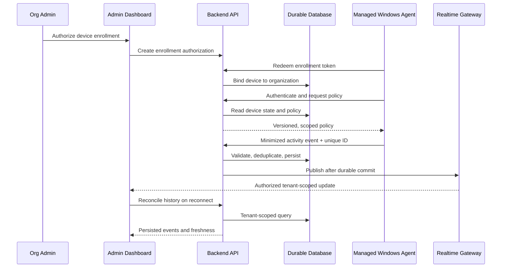

# Phase 0.3 — Data Flow

## Endpoint-to-dashboard event sequence



## Trust boundaries

- User browser to backend: session authentication, CSRF protections where applicable, input validation and server-side role/tenant checks.
- Device agent to backend: TLS, device-scoped credentials, revocation and replay controls.
- Backend to database: private network/least-privilege database identity, parameterized queries and tenant scoping.
- Backend to realtime layer: signed/authorized subscription identity, tenant filtering and event minimization.
- Build pipeline to endpoint: signed, verifiable releases; protected release credentials and staged deployment.

## Event envelope (illustrative, not a frozen API)

```json
{
  "schemaVersion": 1,
  "eventId": "uuid",
  "deviceSequence": 123,
  "deviceOccurredAt": "2026-10-25T03:00:00Z",
  "policyVersion": 4,
  "kind": "application_transition",
  "payload": {
    "applicationId": "approved-normalized-id"
  }
}
```

The backend adds server ingestion time and derives organization ownership from the authenticated device record. The agent must not be allowed to set tenant ownership.

## Timestamp semantics

- `deviceOccurredAt`: endpoint-reported event time; may be skewed.
- `receivedAt`: server time when the request is received.
- `persistedAt`: durable commit time if operationally useful.
- `lastHeartbeatAt`: server-received time of the most recent valid heartbeat.
- Freshness thresholds must be configured and documented; unknown/stale data must not be rendered as current.

## Idempotency and recovery

Use a stable event ID plus device identity and optional monotonic device sequence. Persist deduplication key with a unique constraint. Acknowledge accepted events only after durable persistence. For disconnected agents, use a bounded encrypted queue with expiry, backoff and queue-overflow counters. On reconnect, resume in order where possible, tolerate duplicate/out-of-order delivery and rebuild dashboard state from persisted history.
